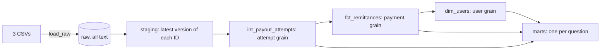

# Remittance Analytics

A dbt and DuckDB project that models a remittance business from 3 source extracts: payments, receipts, and disbursements. It answers the 6 metrics in the assessment, and every number below can be rerun with the commands here.

The extract covers 2026-01-01 to 2026-09-22 UTC, so September is partial.

## Run it

Requires Python 3.13. Put `payments.csv`, `receipts.csv`, and `disbursements.csv` in a `data/` folder. The CSVs are not in this repository.

```bash
python3.13 -m venv .venv && source .venv/bin/activate
```

```bash
pip install -r requirements.txt
```

```bash
dbt run-operation load_raw
```

```bash
dbt build
```

`dbt build` passes 82 items with 0 errors and 0 warnings. Load before you build, because unit tests need the `raw` tables to exist. Close any DuckDB session on `felix.duckdb` first, since it allows one writer.

New data goes in `data/` as `<table>_YYYY-MM-DD.csv`, holding each record's full current state. Run the same two commands. `load_raw` loads only files it hasn't seen, and staging reads only rows loaded since its last run. After changing a staging model, run `dbt build --full-refresh`.

## Results

| # | Metric | Answer | Reproduce |
|---|---|---|---|
| 1 | Amount transacted | $237,075,837 on 720,630 delivered remittances, summed across months | `dbt show -s mart_monthly_volume --limit 12` |
| 2 | Users making up 50% of volume | 59,511 of the 391,244 users with delivered remittances (15.2%) | `dbt show -s mart_user_segments --limit 12` |
| 3 | Recurring customers | 133,760 of those 391,244 users (34.2%) | `dbt show -s mart_user_segments --limit 12` |
| 4 | Providers by failed disbursements | Table below | `dbt show -s mart_provider_failures --limit 12` |
| 5 | Users sending to the same beneficiaries | 0 clusters. See the note below | `dbt show -s mart_shared_beneficiaries` |
| 6 | Chargeback rate | 526 of 730,271 = 0.072%, or 0.079% on mature months, summed across months | `dbt show -s mart_chargeback_rate --limit 12` |

`mart_user_segments` shares use all 421,412 users with a payment, so they read 14.1% and 31.7% where the table says 15.2% and 34.2%.

**Amount transacted by UTC month.**

| Month | Remittances | USD | Top 50% user share | Chargeback rate | Mature |
|---|---:|---:|---:|---:|---|
| 2026-01 | 54,755 | $16,679,288 | 13.1% | 0.078% | Yes |
| 2026-02 | 60,726 | $19,265,513 | 13.4% | 0.054% | Yes |
| 2026-03 | 75,052 | $24,753,796 | 13.6% | 0.086% | Yes |
| 2026-04 | 77,645 | $25,408,576 | 13.7% | 0.094% | Yes |
| 2026-05 | 92,746 | $30,303,038 | 13.9% | 0.103% | No |
| 2026-06 | 89,289 | $30,038,058 | 13.9% | 0.084% | No |
| 2026-07 | 96,149 | $32,372,631 | 14.1% | 0.062% | No |
| 2026-08 | 101,232 | $33,614,833 | 14.0% | 0.054% | No |
| 2026-09 (partial) | 73,036 | $24,640,105 | 13.6% | 0.032% | No |

**Providers.** The failed rate is `failed / (delivered + failed)`. The unsuccessful rate adds cancellations to both sides. Classes are `low` under 1%, `medium` under 3%, and `high` otherwise, with `insufficient_volume` under 1,000 attempts.

| Provider | Attempts | Failed rate | Class | Unsuccessful rate | Class |
|---|---:|---:|---|---:|---|
| 3 | 243,048 | 1.44% | medium | 1.44% | medium |
| 12 | 206,334 | 1.37% | medium | 3.78% | high |
| 8 | 131,807 | 0.44% | low | 4.77% | high |
| 11 | 65,966 | 1.94% | medium | 1.94% | medium |
| 7 | 39,819 | 2.98% | medium | 3.34% | high |
| 5 | 24,524 | 2.83% | medium | 2.87% | medium |
| 4 | 23,426 | 1.93% | medium | 2.00% | medium |
| 9 | 5,166 | 3.74% | high | 3.74% | high |
| 2 | 3,396 | 7.48% | high | 7.48% | high |

Providers 1, 6, and 10 have too few attempts to classify. Providers 7, 8, and 12 change class with the rate, because `failed` and `cancelled` don't mean the same thing at each provider.

**Beneficiary clusters.** No `beneficiary_id` is shared by two users, across all 554,117 IDs, so the literal answer is empty, and a unit test proves the model works when a key is shared. The ID behaves like a sender's saved recipient record. Links through payer or amount would be invented, so there are none. `dim_users.beneficiary_segment` gives a useful view instead: 290,806 users have 1 beneficiary, 92,088 have 2 to 3, 11,796 have 4 to 9, and 90 have 10 or more.

## How it's built



A remittance is one payment. A payout attempt is one receipt plus its disbursement, and 13,215 payments have several attempts. Joining payments to receipts would overstate volume by $6.54M, so each grain is built once and each rule has one owner.

| Requirement | Where |
|---|---|
| R1 dbt project on a database | `dbt_project.yml`, `profiles.yml` |
| R2 Raw load, no seeds | `macros/load_raw.sql` |
| R3 First layer | `models/staging/` |
| R4 Intermediate layer | `models/intermediate/` |
| R5 Modeling | `models/marts/`, `docs/03-project-design.md` |
| R6 to R11 Metrics | The marts in the results table, and `models/marts/_semantic.yml` |
| R12 Tests | `models/*/_*.yml`, `tests/` |
| R13 Repository | This repository |

The marts answer each question. A small semantic layer in `models/marts/_semantic.yml` also defines 13 metrics on the same grains, so a tool or an agent can query them by any dimension. It's optional, and `dbt build` doesn't need it. All 8 checks against the marts match, and `docs/03-project-design.md` section 3.12 has the commands.

## Where the tests are

There are 67 tests. dbt keeps most of them in YAML, next to the models, so `tests/` holds only the custom ones.

| Kind | Count | Where |
|---|---:|---|
| Generic tests: keys, relationships, accepted values, not null | 41 | `_staging.yml`, `_intermediate.yml`, `_marts.yml` |
| Conflicting-version test on each source | 3 | `tests/generic/`, applied in `_sources.yml` |
| Singular tests: reconciliation, the 50% rule, issue baselines, pinned numbers | 4 | `tests/` |
| Unit tests on synthetic rows | 19 | The `unit_tests:` block in each YAML file |

Errors mean a grain or definition broke. Warnings mean a known issue grew or a pinned number moved. `docs/04-data-quality-policy.md` sets out the severity rules and owners.

## Assumptions

The assessment leaves these open. `docs/02-assumptions-and-rules.md` gives the reasoning and evidence.

- **Amount transacted** is the customer-paid amount on delivered remittances, by UTC payment month. Value sent is $234.90M and sits beside it.
- **Promotions** are part of quoted value sent, not customer-paid. Who funds them is unknown.
- **Successful payments with no receipt** are excluded, because there's no payout evidence.
- **Payouts still in flight** are excluded, and `all_successful_payments_usd` ($237.73M) shows the wider total.
- **Recurring** means two consecutive delivered remittances more than 1 day and at most 90 days apart. Recent users have had less time, so `mart_recurring_cohorts` also gives a repeat rate on full windows.
- **When `status` and `raw_status` disagree,** `status` decides, and the conflict stays flagged.
- **The chargeback flag** means a dispute was raised, whatever the outcome. A month counts as mature 120 days after it ends, based on common card dispute windows.

`dbt build --vars '{transacted_measure: value_sent_usd}'` shows what an assumption is worth. Run a default `dbt build` afterward.

## Data observations

`mart_known_issues` lists 21 issues with rows, USD, and baselines. Nothing is corrected, and these are worth a review with the source owners.

- 182 payments ($50.9K) are `SUCCESSFUL` with every payout failed or cancelled and no refund.
- 64 payments have a `CANCELLED` attempt with raw `PAID` or `COMPLETED`. 37 have no delivered attempt, 23 were delivered on a later attempt, and 4 were refunded.
- 1,961 successful payments with no receipt begin in June and are growing. Many repeat fixed amounts.
- Provider 12's cancellations stop on August 10 as its failures rise, while non-delivery holds steady.

## Limitations

- Rates aren't adjusted for country or payout mix.
- The chargeback data has no dispute date or outcome, so rates are by payment month.
- The cut-off is the latest payment in the data. A batch of only late updates doesn't move it.
- Activity before January 2026 isn't visible.

## On BigQuery and at scale

The models use standard SQL and dbt's cross-database macros. On BigQuery, replace `load_raw` with `bq load` or external tables, then change type names and the 3 UTC date expressions.

The load and staging are already incremental, using load time as the watermark. `updated_at` doesn't appear to move with the chargeback flag, so a filter on it would skip a late chargeback. An incremental run matches a full refresh across all 14 data models. At larger scale, facts would recompute only payments touched by a batch. `docs/03-project-design.md` section 3.7 has the detail.

## If I owned this

First, I'd make these numbers trustworthy for the people who use them:

1. Agree on definitions with Finance and Risk, and name one owner for each metric.
2. Reconcile the 182 charged and undelivered payments and the 64 status conflicts against provider statements.
3. Agree on a status contract with each provider, so a label change is announced instead of discovered.
4. Add the dispute date and outcome to the data, so the chargeback rate stops being a proxy.
5. Find out what the growing no-receipt charges are, and decide how to report them.

Then I'd make it run itself: move it to BigQuery with freshness checks, route `mart_known_issues` alerts to their owners, and make the semantic layer the one place every team and dashboard reads metrics from.

## More detail

- `docs/01-assessment-analysis.md` explains the flow and the ambiguous definitions.
- `docs/02-assumptions-and-rules.md` holds rules, rationale, and evidence.
- `docs/03-project-design.md` holds the design.
- `docs/04-data-quality-policy.md` holds the severity rules, owners, and response steps.
- `analysis/` holds the profiling SQL, results, and findings.

AI coding assistants helped with profiling, drafting documents, writing the SQL, and reviewing it. The definitions and decisions are mine, and I checked the numbers against the data.
