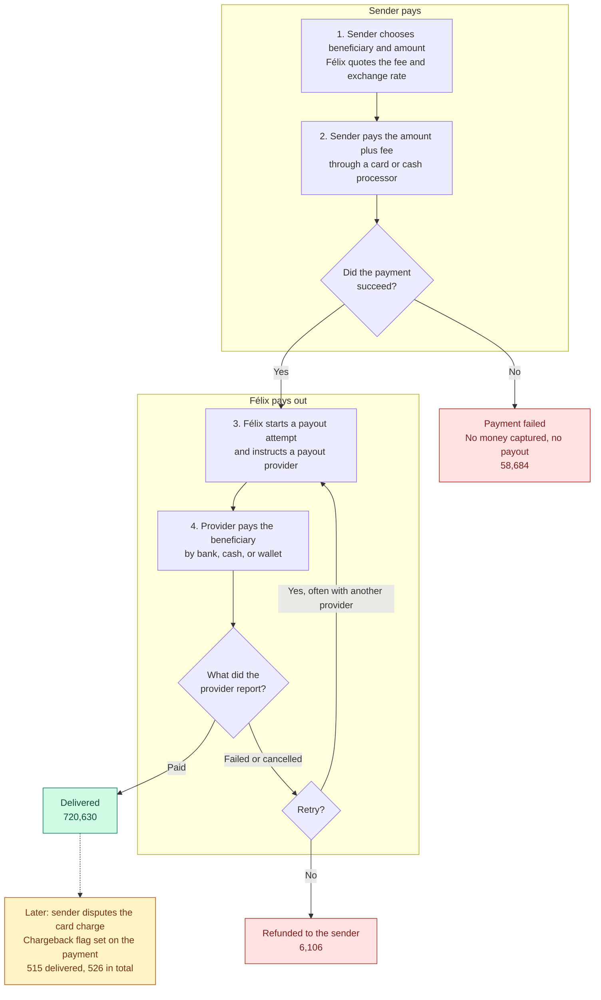
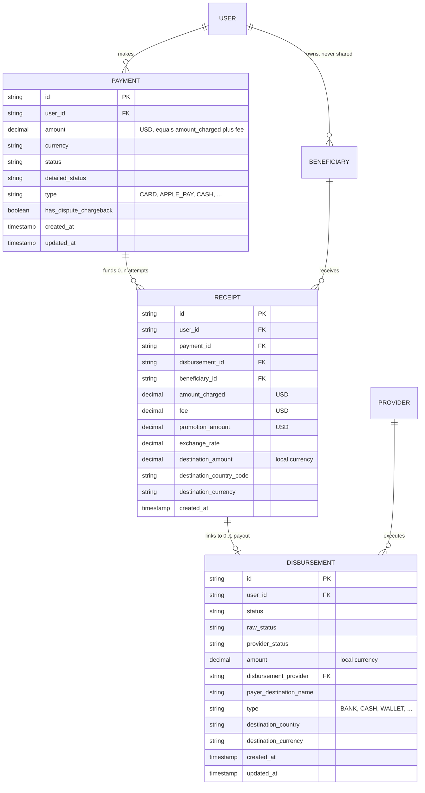

# Assessment Analysis

Scope: understand the problem before building anything. This document explains the remittance flow, lists the required deliverables, identifies ambiguous business definitions, and separates requirements from optional ideas.

All figures come from read-only profiling of the raw CSVs. The extract covers 2026-01-01 to 2026-09-22 UTC, so September is a partial month.

> The assessment leaves these definitions open, so each one below is an **adopted assumption**: a reasoned choice, not a fact about the business. [02-assumptions-and-rules.md](02-assumptions-and-rules.md) gives the rationale and evidence, and [analysis/findings.md](../analysis/findings.md) has the full profiling.

## 1. Key findings

| # | Finding | Why it matters |
|---|---|---|
| 1 | `beneficiary_id` is never shared by two users (0 of 554,117). | The clusters metric returns nothing if built literally. See 5.5. |
| 2 | One payment can have several receipts and disbursements: 13,215 payments have more than one, usually a retry. | The remittance grain is the payment, not the receipt. A naive join overstates successful volume by $6.54M. |
| 3 | Payment rows total $268.0M, but delivered remittances total $237.1M. | "Amount transacted" needs an explicit definition. Counting all rows overstates volume by about 13%. |
| 4 | Provider rankings change with the treatment of `CANCELLED`. Provider 8 is 4.75% if cancellations count as failures and 0.42% if they don't. | The ranking is only meaningful with a stated failure definition. |
| 5 | `status` and `raw_status` can disagree. Provider 3 has 3,070 rows with status `Failed` and raw status `cancelled`. | Provider 3 moves from 1.44% to 0.18% under a strict definition. Those rows close as fast as its other failures, so 1.44% looks right. See 5.4. |
| 6 | IDs are already unique in all 3 files, with no exact duplicates. | Deduplication stays in the first layer as required, but removes 0 rows here. Retries must not be removed as duplicates. |
| 7 | Payment status can change after payout. 2 ACH payments became `FAILED` days after being paid out. | Payment status is the latest state, not a final one. |
| 8 | `failed` and `cancelled` aren't comparable across providers. Provider 12's cancellations fall from 797 a month to 0 as its failures rise from 76 to 620, while non-delivery stays at 3.4% to 4.2%. | A failed-only rate can mislead, so provider classes need a second view. See 5.4. |
| 9 | On January 22, 18 Provider 4 rows ($4,562.58) were cancelled with raw `COMPLETED`, and Provider 3 delivered 17 of them after a re-route. | Worth a review. The data can't show what the first provider did. See section 6. |
| 10 | Only 3.3% to 5.6% of a month's top users stay in the top group the next month. | The concentration is stable, but the people aren't. See 5.2. |

## 2. Company and role context

Félix lets Latinos in the US send money home through a conversational WhatsApp experience. Senders mostly pay by card, and recipients receive money through a bank, a cash pickup, or a mobile wallet. Its website lists 11 Latin American destinations. The job post describes remittances as the starting point for credit, savings, and wallet products.

The role is a Data Engineering Manager in a GCP, BigQuery, dbt, and Flink environment. Three lines from the job post should shape this solution:

- **"Focus on why data and metrics exist."** Each metric should state the decision it supports.
- **"High standards for data quality, testing, observability."** Tests should encode business rules, not only uniqueness and null checks.
- **"Clean architecture, platform governance, and documentation."** Definitions and trade-offs should be written down, and the design should stay simple.

DuckDB is a reasonable local choice, since the assessment allows any database. Keeping the SQL close to standard makes a later move to BigQuery straightforward, and the README can say what would change.

| Metric | Business decision it supports |
|---|---|
| Amount transacted by month | Growth tracking, and a shared baseline for finance and leadership |
| Top users by 50% of volume | Revenue concentration, VIP retention, and risk review |
| Recurring customers | Retention and the base for cross-selling credit, savings, and wallet products |
| Provider failure classification | Routing, vendor management, and customer experience |
| Users sharing beneficiaries | Fraud and AML network review, and possibly household or referral insight |
| Chargeback rate | Card-processing risk and fraud controls |

## 3. The remittance flow

### 3.1 Business flow

Read this from top to bottom. The colored boxes are the main outcomes, and the counts are payments in this extract.

Each step leaves a record in the source files:

| Step | Who acts | Record written |
|---|---|---|
| 2. Payment | Sender and processor | 1 row in `payments`, even if the payment fails |
| 3. Payout attempt | Félix | 1 row in `receipts` and 1 row in `disbursements` for each attempt |
| Retry | Félix | A new receipt and disbursement on the same payment. 13,215 payments have more than one attempt. |
| 4. Provider result | Payout provider | Status updated on the disbursement |
| Refund or chargeback | Félix or processor | Status or chargeback flag updated on the same payment |

Section 3.3 covers every outcome, including payouts still in flight.

The median time from payment to disbursement is about 5.5 seconds, so the flow is close to real time. Félix's public materials also describe stablecoin rails for moving funds, but these do not appear in the data and are out of scope.

### 3.2 Data model as observed

`USER`, `BENEFICIARY`, and `PROVIDER` are not source files. They are inferred from ID and name columns.

The diagram shows every source column except 4 on `payments`: `error_code` and `reason` are 100% null, `total_intents` is 97.9% null, and `location_of_request_state_code` is 99.9% null. Types show the intended model types, since the raw load keeps everything as text.

| Relationship or rule | Evidence |
|---|---|
| Receipt to disbursement is 1:1 | No disbursement ID appears on more than one receipt. All 743,763 disbursements have a receipt. |
| Payment to receipt is 1:N | 715,012 payments have 1 receipt, 13,215 have 2 to 8, and 60,749 have none. |
| Failed payments do not create receipts | 58,684 of 58,687 failed payments have no receipt. |
| `user_id` is consistent | There are 0 mismatches between the three files. |
| Payment amount = `amount_charged` + `fee` | Holds for 99.9% of joined rows. The main exception is a receipt showing a $0 fee while the payment includes one. |
| USD value sent = `amount_charged` + `promotion_amount` | Multiplying by `exchange_rate` gives `destination_amount` for 13,982 of 13,983 promotional receipts. |

**Grain decision:** a remittance is one payment, and a payout attempt is one receipt plus its disbursement. Most analytics should work at one of these two grains, depending on the question.

### 3.3 Remittance outcomes

| Payment status | Payout result | Payments | USD | Interpretation |
|---|---|---:|---:|---|
| `SUCCESSFUL` | Paid once | 720,611 | $237.07M | Delivered |
| `SUCCESSFUL` | Paid more than once | 19 | $5.5K | Delivered, with more than one delivered attempt |
| `SUCCESSFUL` | In flight or unknown | 1,279 | $563.0K | Not confirmed as delivered |
| `SUCCESSFUL` | All attempts failed | 182 | $50.9K | Charged, not paid, and not marked refunded |
| `SUCCESSFUL` | No receipt | 1,961 | $40.7K | Probably not a remittance (see section 6) |
| `REFUNDED` | All attempts failed | 6,106 | $2.65M | Refunded as expected |
| `REFUNDED` | Paid or unknown | 27 | $15.4K | Includes 7 both paid and refunded; needs review |
| `REFUNDED` | No receipt | 86 | $33.6K | Refunded before any payout attempt |
| `FAILED` | No receipt | 58,684 | $27.57M | Attempted, but no money captured |
| Other | Any | 21 | $8.0K | Pending, started, or inconsistent states |

These groups add up to all 788,976 payments. Implementation should enforce that reconciliation with a test.

Two kinds of exception stand out, though neither counts as volume:

- The 2 `FAILED` payments with payouts inside "Other" are both ACH, and they failed for insufficient funds 2 to 5 days after creation. That fits a settlement bounce after an instant payout.
- The 7 paid and refunded payments are all card. On 5, the payout's last update comes after the payment's last update, so a refund may have overlapped an open payout. This is unconfirmed.

## 4. Required deliverables

| # | Requirement | Acceptance criteria |
|---|---|---|
| R1 | dbt project connected to a database | `dbt build` runs against DuckDB from a clean clone. |
| R2 | Raw ingestion of 3 CSVs into a raw schema | A repeatable load step creates raw tables. **dbt seeds are not allowed.** |
| R3 | First layer | One model per source that deduplicates and applies types, naming, and standard values. |
| R4 | Intermediate layer | Joins common data by business context. |
| R5 | Data modelling | Clear grains and documented design choices. |
| R6 | Metrics: amount transacted by month | Monthly mart. |
| R7 | Metrics: users representing 50% of volume | User-level classification. |
| R8 | Metrics: recurring customers | Written definition and classification. |
| R9 | Metrics: providers by failed disbursements | Provider-level rates and classification. |
| R10 | Metrics: clusters of users sending to the same beneficiaries | Output and a clear explanation of the identifier limitation. |
| R11 | Metrics: chargeback rate | Rate with stated numerator and denominator. |
| R12 | Data tests | Tests across the models. |
| R13 | GitHub repository | Project is pushed and the link is shared. |

**Repository constraint:** the repository is public, and the CSVs are 194 to 289 MB each, so the data stays out of Git and the README explains where to place it.

## 5. Ambiguous business definitions

### 5.1 What counts as "amount transacted"?

| Option | Total | Assessment |
|---|---:|---|
| All payment rows | $268.0M | Wrong: includes failed payments |
| `SUCCESSFUL` payments | $237.7M | Includes unconfirmed payouts and non-remittance items |
| **Delivered remittances, customer-paid amount** | **$237.08M** | **Adopted** |
| Delivered principal, excluding fees, including promotions | About $234.9M | Useful companion measure |

**Adopted assumption:** count `payments.amount` when the payment is `SUCCESSFUL` and at least one payout attempt is delivered. This gives 720,630 remittances.

- Use the payment `created_at` month in UTC, and mark September as partial.
- Keep principal, fees, and promotions as separate measures. This matters because 2,953 receipts are fully funded by promotion, so `payments.amount` understates the value sent on those rows.
- Do not sum `destination_amount` across currencies.
- Do not subtract chargebacks from volume, since chargebacks have their own metric.

The choice barely changes the story, and exposing the measures side by side makes it easy to switch:

- Customer-paid and value sent differ by only 0.76% to 1.03% a month, and January to August growth is 101.54% against 101.75%.
- Promotions ($0.72M) are treated as an additional component of quoted value sent, so they sit inside value sent and outside customer-paid. The funding source is unknown.

### 5.2 Who represents 50% of volume?

On the adopted volume definition, **59,511 of 391,244 users (15.2%)** make up 50% of volume. Of the 391,244, 35 have only $0 remittances (see section 6). The threshold is roughly $1,189 of volume per user.

**Adopted assumption:**

- Rank users by delivered volume over the full extract, highest first.
- Include the user who crosses the 50% line.
- Break ties with `user_id` so results are repeatable.
- Label users `top_50_pct_volume` or `long_tail`.

The output also shows each month's concentration, and the group is called "top 50% of extract volume" so it doesn't imply a stable VIP list:

- The share is steady: 13.1% to 14.1% of users make 50% of each month's volume.
- The people change: only 3.3% to 5.6% of a month's top group stays in it the next month.
- The full extract favors tenure: 21.2% of January's cohort are top users, against 10.0% of August's. With equal 90-day exposure, the share is flat at 13.6% to 16.5%.

### 5.3 What is a recurring customer?

Senders commonly return roughly monthly: the median gap between successful payments is 33 days, with a 75th percentile of 68 days.

| Candidate definition | Users | Share | Assessment |
|---|---:|---:|---|
| At least 2 delivered remittances | 160,590 | 41.0% | Too loose: same-day sends qualify |
| Delivered in at least 2 calendar months | 144,758 | 37.0% | Depends on where a user's first send falls in the month |
| Delivered in at least 3 calendar months | 58,727 | 15.0% | Better as a "loyal" tier |
| Two consecutive delivered remittances more than 1 day and at most 60 days apart | 117,010 | 29.9% | Drops a monthly sender who skips one month |
| **Two consecutive delivered remittances more than 1 day and at most 90 days apart** | **133,760** | **34.2%** | **Adopted: measures the habit directly** |

**Adopted assumption:** a recurring customer has two consecutive delivered remittances more than 1 day and at most 90 days apart. The 1-day floor keeps split same-day sends out. It has a known edge: someone sending about once a day, with no gap over 1 day, never qualifies. 1,289 users have 2 or more sends with every gap within 1 day, and only 17 of them have 3 or more sends.

Recent users have had less time to qualify: 50.1% of January's first-month group qualify, against 17.7% of August's. Activity before January 2026 is not visible, so January's group includes existing customers. A comparable measure sits beside it: the share with a repeat within 90 days of the first send, among users with a full 90-day window. It's a separate measure from the classification, which looks at every gap between consecutive sends. That's 41.9% for January and 34.2% for June.

What the analysis shows:

- Calendar months have a bias: within the same 60 days, the 2-month rule qualifies 17.8% of users who start in a month's first week and 26.8% who start in the last. A 60-day repeat is flat at about 28%.
- 83.9% of gaps are within 90 days, against 70.8% within 60.
- Both rules predict later activity about equally, so nothing is lost by measuring the habit directly.

### 5.4 What is a failed disbursement, and how should providers be classified?

The status vocabulary varies by provider and must be standardized first.

| Standard status | Source values, case-insensitive |
|---|---|
| Delivered | `paid`, `success`, `completed`, `delivered` |
| Failed | `failed`, `rejected`, `error_sending_payout_request`, `payout_not_processed` |
| Cancelled | `cancelled` |
| In flight | `payable`, `wire_released`, `wire_confirmed`, `transmitted`, `in_progress`, `pending`, `to_be_processed`, `on_hold`, `hold_by_compliance`, `hold_by_payer`, `cancellation_in_progress` |

Failure rates under each reading, per attempt, for `failed` and `rejected` rows:

| Provider | Attempts | Failed + cancelled | Strict, from `status` | Strict, from `raw_status` |
|---|---:|---:|---:|---:|
| Provider 3 | 243,048 | 1.44% | 1.44% | **0.18%** |
| Provider 12 | 206,334 | 3.78% | 1.33% | 1.33% |
| Provider 8 | 131,807 | 4.75% | 0.42% | 0.42% |
| Provider 11 | 65,966 | 1.94% | 1.94% | 1.94% |
| Provider 7 | 39,819 | 3.32% | 2.95% | 2.95% |
| Provider 5 | 24,524 | 2.84% | 2.80% | 2.80% |
| Provider 4 | 23,426 | 2.00% | 1.93% | 1.93% |
| Provider 9 | 5,166 | 3.74% | 3.74% | 3.74% |
| Provider 2 | 3,396 | 7.48% | 7.48% | 7.48% |
| Provider 6 | 268 | 10.07% | 10.07% | 10.07% |
| Provider 10 | 6 | 66.67% | 0.00% | 0.00% |
| Provider 1 | 3 | 66.67% | 66.67% | 66.67% |

**Adopted assumption:**

- Measure at the attempt grain, because that is where provider performance occurs.
- **`status` decides, and `raw_status` only raises a conflict flag.** Provider 3's 3,070 conflict rows close in a median of 0.47 minutes, like its other failures (0.36 minutes) and unlike cancellations at Provider 8 (146 minutes) or Provider 12 (223 minutes). Provider 3 therefore stays at 1.44%, and the 0.18% reading is dropped. This rule is supported by behavior, not proven.
- Calculate the failed rate as `failed / (delivered + failed)`, which is slightly higher than the strict rates above. Provider 8 moves from 0.42% to 0.44%.
- Classify providers by that rate: `low` below 1%, `medium` from 1% to below 3%, and `high` at 3% or above.
- Publish a second class on the **unsuccessful terminal rate**, `(failed + cancelled) / (delivered + failed + cancelled)`, plus a label-sensitive flag. A cancellation might come from a user, operations, compliance, or the provider, so this rate counts outcomes and doesn't assign fault.
- Mark providers with fewer than 1,000 attempts as `insufficient_volume`.

The second class exists because the labels mean different things by provider: Provider 8 uses `failed` only for instant rejections, and Provider 12's labels shift during the year.

| Provider | Failed rate | Class | Unsuccessful terminal rate | Unsuccessful class |
|---|---:|---|---:|---|
| Provider 8 | 0.44% | `low` | 4.77% | `high` |
| Provider 12 | 1.37% | `medium` | 3.78% | `high` |
| Provider 7 | 2.98% | `medium` | 3.34% | `high` |

These are the only 3 label-sensitive providers. The 1% and 3% thresholds are a stated convention. Providers 5 and 7 are within sampling noise of 3%, but their first-attempt rates (2.54% and 2.68%) are clearly `medium`.

Customer impact is a separate view. Of 18,313 payments with a failed or cancelled attempt, 11,975 (65%) also have a delivered attempt, and on 11,968 the delivery came after that attempt. The other 6,338 were never delivered.

**Limitations:** provider mix differs by country and payout type, so rates are not fully like-for-like. Retries also send harder cases to fallback providers, so the mart shows a first-attempt rate as well. Classes match on all and first attempts for every provider.

### 5.5 What are clusters of users sending to the same beneficiaries?

**The direct definition produces no clusters.** Every one of the 554,117 beneficiary IDs belongs to exactly one user. The likely reason is that the ID identifies a saved recipient record per sender, or that it was anonymized per user, but the data alone cannot prove this. About 3,000 multi-receipt payments changed beneficiary ID during retries, which also suggests the ID is not a stable person key.

| Option | Assessment |
|---|---|
| A. Literal shared-beneficiary clusters | Correct, but returns 0 clusters on this extract |
| B. Proxy from `payer_destination_name`, country, or type | Rejected: there are only 213 payer values, which are likely institutions, not people, so it would create false links |
| C. Segment users by beneficiary count | Useful and honest, but answers a different question |

**Adopted assumption:** combine A and C.

1. Build a simple user-to-beneficiary model with all observed pairs, and the literal shared-beneficiary output, which is empty today. If a global beneficiary key becomes available, it can populate this output.
2. Publish a clearly named beneficiary-count segmentation as the useful output for this extract, counted on first observed attempts because 2,060 users have extra IDs created only by retries.
3. Explain the limitation in the README rather than inventing links.

A full graph algorithm is not justified while there are no shared-beneficiary links.

**Stated assumption:** the README should say that `beneficiary_id` is a sender's saved recipient record, not a global person key.

| Beneficiaries | All attempts | First observed attempts |
|---|---:|---:|
| 1 | 289,700 | 290,806 |
| 2 to 3 | 92,942 | 92,088 |
| 4 to 9 | 12,044 | 11,796 |
| 10 or more | 94 | 90 |

The evidence also supports the saved-record reading and rules out proxy clusters:

- 53% of repeat payments reuse an earlier ID, and IDs never span countries.
- The best proxy rule (same payer, type, and exact amount within 10 minutes) gives 14,439 user pairs, but shuffled data explains about 91% of them. This test is a heuristic.
- The most new IDs any user added in 24 hours is 3, so there are no velocity outliers.

### 5.6 What is the chargeback rate?

| Measure | Result |
|---|---:|
| Chargeback-flagged payments | 526 |
| Settled payments (`SUCCESSFUL` + `REFUNDED`) | 730,271 |
| **Rate by count** | **0.072%** |
| Chargeback USD | $228.5K |
| **Rate by USD** | **0.095%** |

**Adopted assumption:** report both rates by payment month, using settled payments as the denominator, and read the flag as "a dispute was raised", whatever the outcome. Payment type stays on the fact, so a card-only rate is easy to reproduce: card and Apple Pay give 526 of 729,501, or 0.0721%, against 0.0720%. These are different populations that match on this extract, so a separate view adds nothing here.

**Limitations:**

- The data has a flag, but no dispute date, amount, or outcome. The rate is therefore a cohort rate by payment month, not disputes received in a month.
- Recent months look better because disputes arrive late. September's 0.032% is not comparable to May's 0.103%.
- The flag may not distinguish won and lost disputes.
- `updated_at` can't stand in for a dispute date, because flagged payments show a median update lag of 0 days.

A month counts as mature 120 days after it ends. January to April give 0.0793% by count and 0.1037% by value. The data can't separate 60, 90, and 120 days, so three reasons decide it: card networks commonly allow disputes for up to about 120 days (outside knowledge), calling a month mature too early would understate risk, and the flag is only a label that removes no data.

The evidence for the flag's meaning is thin: no status mentions disputes, and 525 of 526 flagged payments stay `SUCCESSFUL`. Two patterns are worth noting: 75.7% of flags are on a user's first settled payment, and 5.03% of paid, undelivered, unrefunded card payments are flagged, against 0.072% of delivered ones. Flagged payments are also followed by less activity, but with no flag date, the data can't say why.

## 6. Data quality observations

| Observation | Scale | Treatment |
|---|---:|---|
| Status casing and provider vocabularies differ | 20 normalized values | Lowercase in staging, and map in the intermediate layer with a test for new values |
| `COSTA RICA` instead of `CR` | 25 disbursements | Standardize to `CR` |
| Null disbursement country | 137 rows | Fill from the receipt in the intermediate layer |
| Null disbursement amount | 568 rows, all Provider 3 or 12 | Keep; use the receipt amount where a value is needed |
| Null disbursement `updated_at` | 816 rows | Fall back to `created_at` when ordering |
| Country mismatch between receipt and disbursement | 1 row after standardizing | Use the receipt value and keep the row |
| Receipts with no disbursement record | 185 rows | Keep, classify as `missing`, and track as a known issue |
| Negative `amount_charged` | 1 row | Keep raw and flag |
| Payment amounts beyond 2 decimals | 827 rows | Keep exact in staging: 687 are float32 values, and 125 trace to calculated amounts |
| `updated_at` before `created_at` | 18 rows | Allow for truncation: all 18 are whole-second values |
| Currency conflicts or USD rate other than 1 | 5 receipts | Track as a known issue; all payouts failed or were cancelled, but one $100 payment is still `SUCCESSFUL` |
| ACH payments pending settlement | 10 rows, $3,942 | Count as delivered for now, and monitor |
| Delivered payout on a `FAILED` or `REFUNDED` payment | 9 payments, $2,410 | Exclude from volume, and track as a known issue |
| Payment amount of zero or below | 134 rows | Flag. 97 are delivered remittances, on 96 users. They stay delivered, because they carry $11,494 of value sent, and they add $0 to customer-paid volume. 35 users have only these. Without them, recurring would be 133,740 instead of 133,760 |
| Payment doesn't tie to the primary attempt | 887 delivered remittances, net $2,971 | Keep and monitor. 717 receipts show a $0 fee while the payment includes one (+$3,141), 146 receipts are higher (−$194), and 24 are other (+$24). `fee_usd` is understated by about $3.1K |
| Disbursement created over a minute before its receipt | 753 rows, the longest by 69 days | Keep and monitor. Attempts stay ordered by receipt time; ordering by disbursement time would change the first attempt on 3 payments |
| Successful payment with no receipt | 1,961 rows, $40.7K | Exclude from remittances, because there's no payout evidence, and monitor by amount family: `6.25 × n − 0.25` (1,173 rows, 66% on Saturdays, 60% at 11:00 UTC), $1.00 (704), and other (84). They begin in June 2026. Many look like scheduled charges, but the product is unknown |
| `error_code` and `reason` columns | 100% null | Keep in raw, and drop from later layers |
| `total_intents` | 97.9% null, only value is `1` | Keep in raw, and drop from later layers |
| `location_of_request_state_code` | 99.9% null, mixed formats | Not reliable for analysis |
| More than one delivered attempt | 19 payments | Track as a known issue |
| Charged, undelivered, and not refunded | 182 payments, $50.9K | Track as a known issue |
| `CANCELLED` with raw `PAID` or `COMPLETED`, and no delivered attempt | 37 payments, $18,527 | Keep out of volume, and name the issue `cancelled_with_paid_raw_status`; 90% were never refunded, against 1.7% after plain cancels, so these may have been delivered |
| Cancelled with raw `PAID` or `COMPLETED`, then delivered on a later attempt | 23 payments, $7,315 | Name the issue `cancelled_then_delivered`. It includes 17 Provider 4 rows on January 22 that Provider 3 delivered. The data can't show what the first provider did |

Severity should be intentional. Structural problems such as duplicate primary keys or broken grain should fail the build. Known source issues should warn and remain visible.

## 7. Requirements and optional ideas

### Must do

- Everything in section 4.
- Remittance grain and attempt grain handled explicitly.
- Written metric definitions, with stated assumptions.
- A short, standalone README that lets a reviewer reproduce the project and shows each metric's actual result.

### Should do, at low cost

- One status rule that keeps vocabulary changes in one place.
- Reconciliation tests, for example payment outcomes summing to the payment total.
- dbt descriptions for key models and columns.
- A short "what would change on BigQuery" section.
- One known-issues table with dollar exposure, and a warning test on its baselines.

### Possible extensions

- Corridor or payout-type breakdown of provider failures. Done, with no new model. `analysis/sql/17_provider_mix.sql` holds the comparison, and the semantic layer can group `provider_failed_rate` by destination and payout type.
- Cohort retention chart. Left out. Retention isn't one of the 6 metrics, and `mart_recurring_cohorts` already gives each cohort's 90-day repeat rate. The extract starts in January, so early cohorts mix new and existing customers, and each cohort's latest month is partial.

### Avoid

- Orchestration tools, Docker, or cloud infrastructure.
- Incremental facts or snapshots. The load and staging are incremental, and later layers rebuild, because the data is small.
- Streaming or Flink. A short note on how the design might evolve is enough.
- Machine-learning clustering or a graph library.
- A full star schema with dimensions that have little attribute data. Marts should exist only when they answer a real question.

## 8. Decisions

[02-assumptions-and-rules.md](02-assumptions-and-rules.md) lists each assumption with its limitation and evidence, [03-project-design.md](03-project-design.md) turns them into a project, and [04-data-quality-policy.md](04-data-quality-policy.md) sets the data quality rules.

## Sources

- [Félix Data Engineering Manager job post](https://jobs.gem.com/felix/am9icG9zdDobdeGD2JZB5SKocG3Vjbuz)
- [Félix website](https://www.felixpago.com/)
- [Stripe customer story on Félix](https://stripe.com/ie/customers/felix)
- [dLocal and Félix stablecoin-funded remittances coverage](https://thepaypers.com/crypto-web3-and-cbdc/news/felix-and-dlocal-launch-stablecoin-whatsapp-remittances)
