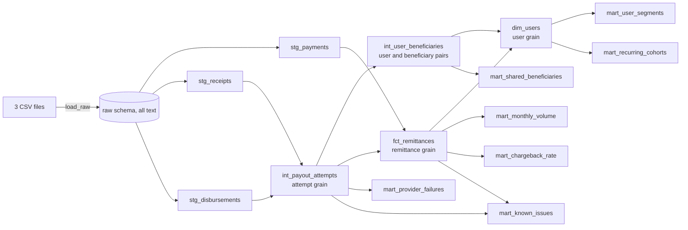

# Project Design

This is the design for the whole dbt project. It builds on [01-assessment-analysis.md](01-assessment-analysis.md), [02-assumptions-and-rules.md](02-assumptions-and-rules.md), and [analysis/findings.md](../analysis/findings.md).

Doc 02 owns the assumptions, status rules, money rules, and metric definitions. This document owns models, configuration, and tests.

## 1. Problem

Six metrics have to come from three CSVs, and their definitions are ours to state. Most wrong answers in this data come from two mistakes:

- **Mixing grains:** joining payments to receipts overstates volume by $6.54M.
- **Applying a policy twice:** Provider 8 moves between 0.44% and 4.77% depending on how `CANCELLED` is treated.

So the design has three rules:

1. Each grain is built once.
2. Each policy has one owner.
3. Changing an assumption changes a value or a condition, never a grain.

The audience also shapes it. Reviewers are data leaders at a regulated fintech that runs BigQuery and dbt, so the project should show why each metric exists, test business rules, make known data problems visible, and stay small.

## 2. Usage

The design starts from what a reviewer runs and what an analyst queries.

### Reviewer

Requires Python 3.13. The CSVs go in `data/`, which is not committed.

```bash
python3.13 -m venv .venv && source .venv/bin/activate
```

```bash
pip install -r requirements.txt
```

```bash
dbt run-operation load_raw
```

```bash
dbt build
```

When new data arrives, add its files to `data/` and run the same two commands. Section 3.7 covers the file rules.

```bash
dbt show -s mart_monthly_volume --limit 12
```

```bash
dbt show -s mart_known_issues --limit 20
```

To see what an assumption is worth, without editing anything:

```bash
dbt build --vars '{transacted_measure: value_sent_usd}'
```

### Analyst

Finance reads the headline, with September marked as partial:

```sql
select payment_month, transacted_usd, delivered_remittances, is_partial_month
from mart_monthly_volume
order by payment_month;
```

Retention finds high-value users who haven't formed a habit:

```sql
select user_id, transacted_usd, first_delivered_at
from dim_users
where volume_class = 'top_50_pct_volume' and not is_recurring
order by transacted_usd desc;
```

Vendor management ranks providers, then drills into the attempt grain:

```sql
select provider, failed_rate, first_attempt_failed_rate, unsuccessful_terminal_rate,
       failure_class, unsuccessful_class, is_label_sensitive
from mart_provider_failures
order by failed_rate desc;

select payout_type, country_code, attempt_status, count(*) as attempts
from int_payout_attempts
where provider = 'PROVIDER 8'
group by all;
```

These queries set the requirements: marts need no filter to remember, user attributes live in one table, and the attempt grain is open to analysts.

## 3. Shape

### 3.1 Lineage



### 3.2 Layers

| Layer | Rule | Assessment requirement |
|---|---|---|
| `raw` | Append-only source values as text, plus `_loaded_at` and `_source_file` | R2 |
| `staging` | Keep the latest version of each ID, cast, rename, and standardize. No business policy. | R3 |
| `intermediate` | Join by business context, and decide what happened to each attempt | R4 |
| `marts` | Facts, the user dimension, and one output per business question. Marts never reinterpret a status. | R5 to R11 |

All models are tables in DuckDB's `main` schema, and `raw` is the only other schema. The prefixes already show the layer, so no schema macro is needed. Tables also make a bad cast fail at the model that caused it, and the data is small.

### 3.3 Repository

```text
.
├── README.md
├── dbt_project.yml         # includes the vars for adopted assumptions
├── profiles.yml            # local DuckDB, no secrets
├── requirements.txt        # dbt-core 1.12.6 and dbt-duckdb 1.11.1
├── requirements-semantic.txt  # optional: adds MetricFlow
├── .gitignore
├── data/                   # CSVs, never committed
├── macros/
│   └── load_raw.sql        # the only macro
├── models/
│   ├── staging/
│   │   ├── _sources.yml    # the one list of raw tables
│   │   ├── _staging.yml
│   │   └── stg_payments, stg_receipts, stg_disbursements
│   ├── intermediate/
│   │   ├── _intermediate.yml
│   │   └── int_payout_attempts, int_user_beneficiaries
│   └── marts/
│       ├── _marts.yml      # metric definitions live here
│       ├── _semantic.yml   # semantic models and metrics
│       ├── metricflow_time_spine
│       ├── fct_remittances, dim_users
│       └── mart_monthly_volume, mart_user_segments, mart_recurring_cohorts,
│           mart_provider_failures, mart_shared_beneficiaries,
│           mart_chargeback_rate, mart_known_issues
├── tests/
│   ├── generic/no_conflicting_versions.sql, generic/country_code.sql
│   ├── staged_amounts_keep_source_precision.sql
│   ├── marts_reconcile_to_facts.sql
│   ├── top_users_cross_half.sql
│   ├── known_issues_within_baseline.sql
│   └── extract_golden_numbers.sql
├── docs/                   # analysis, assumptions, design, quality policy, business findings
└── analysis/               # profiling SQL, results, findings, semantic check
```

### 3.4 Models

Types follow doc 02 section 6. Models never round.

| Model | Grain and key | Rows | Owns |
|---|---|---:|---|
| `stg_payments` | Payment, `payment_id` | 788,976 | Casts, `payment_month` |
| `stg_receipts` | Receipt, `receipt_id` | 743,948 | Casts, `beneficiary_key` |
| `stg_disbursements` | Disbursement, `disbursement_id` | 743,763 | Casts, lowercase statuses, `COSTA RICA` to `CR` |
| `int_payout_attempts` | Attempt, `receipt_id` | 743,948 | `attempt_status`, `status_conflict_type`, attempt order, primary attempt, `is_followed_by_delivery` |
| `int_user_beneficiaries` | `user_id`, `beneficiary_key` | 554,117 | All observed pairs, with `is_on_first_attempt` |
| `fct_remittances` | Payment, `payment_id` | 788,976 | Attempt rollup, `payout_outcome`, money measures, eligibility flags, `transacted_usd`, `payment_type`, `extract_end_at` |
| `dim_users` | User, `user_id` | 421,412 | Volume class, recurring flag, repeat within window, beneficiary segment |
| `mart_monthly_volume` | UTC month | 9 | Volume measures, `top_50_pct_user_share`, monthly senders, `is_partial_month` |
| `mart_user_segments` | `segment_type`, `segment` | 11 | User counts and volume by class and segment |
| `mart_recurring_cohorts` | First delivered month | 9 | Recurring share and 90-day repeat rate |
| `mart_provider_failures` | Provider | 12 | Rates, rescued attempts, both classes, `is_label_sensitive` |
| `mart_shared_beneficiaries` | Shared `beneficiary_key` | 0 | The literal R10 output |
| `mart_chargeback_rate` | UTC month | 9 | Count and value rates on settled payments, `is_mature` |
| `mart_known_issues` | Issue | 21 | Issue definitions, rows, USD, and baselines |
| `metricflow_time_spine` | Day | 365 | Calendar for MetricFlow. It holds no business logic |

Each staging model keeps one row per ID: the latest file wins, then the latest `updated_at`, with `created_at` as the fallback. File order comes first because setting the chargeback flag doesn't appear to move `updated_at`. Receipts have no `updated_at`, so they use `created_at`.

```sql
qualify row_number() over (
  partition by id
  order by _source_file desc, coalesce(updated_at, created_at) desc
) = 1
```

Identical rows collapse here. Two different rows tied on ID, file, and timestamp have no correct winner, and input order would otherwise decide. `no_conflicting_versions` is a generic test on each source table, so it fails on such a tie and dbt skips that table's staging model. It has to be a test on one source: a single test across all 3 sources failed but didn't stop staging.

**`stg_payments`** drops `error_code`, `reason`, `total_intents`, and `location_of_request_state_code`, which stay in raw. The month is explicit, so it doesn't depend on the session time zone:

```sql
cast(date_trunc('month', created_at at time zone 'UTC') as date) as payment_month
```

**`int_payout_attempts`** holds all of doc 02 section 4.1 in one `CASE`. `status` decides, and `raw_status` only feeds `status_conflict_type`:

```sql
case
  when d.disbursement_id is null then 'missing'
  when d.status = 'cancelled' then 'cancelled'
  when d.status in ('paid', 'success', 'completed', 'delivered') then 'delivered'
  when d.status in ('failed', 'rejected', 'error_sending_payout_request',
                    'payout_not_processed') then 'failed'
  when d.status in ('payable', 'wire_released', 'wire_confirmed', 'transmitted', 'in_progress',
                    'pending', 'to_be_processed', 'on_hold', 'hold_by_compliance',
                    'hold_by_payer', 'cancellation_in_progress') then 'in_flight'
  else 'unknown'
end as attempt_status
```

`missing` must test `d`, the joined disbursement. All 185 unmatched receipts carry a `disbursement_id` that points to no record, so testing the receipt's own column would send them to `unknown` and fail the build.

**`int_user_beneficiaries`** keeps every observed pair, so a beneficiary shared only on a retry still reaches the literal output. First observed attempts and the primary attempt are separate ideas: the first is `attempt_number = 1`, and the second is the earliest delivered attempt.

```sql
select user_id, beneficiary_key, bool_or(attempt_number = 1) as is_on_first_attempt
from {{ ref('int_payout_attempts') }}
group by 1, 2
```

**`fct_remittances`** starts from `stg_payments`, so all payments survive (S2, S10). The attempt rollup is a CTE, because it has one reader and the same grain as the fact. Its outcome and flags follow doc 02 sections 4.2 and 7.

```sql
case when is_delivered_remittance then {{ var('transacted_measure') }} end as transacted_usd
```

`transacted_usd` is null on ineligible rows, so `sum(transacted_usd)` is correct without a filter. `payment_type` stays on the fact, so a card-only rate is one `where` clause away.

**`mart_monthly_volume`** adds `top_50_pct_user_share`: the share of each month's senders who make 50% of that month's volume. A CTE ranks users within the month, using the same tie-break as `dim_users`. On this extract it's 13.1% to 14.1%.

The same user-month CTE gives `active_senders`, `first_seen_senders`, and `returning_senders`. The names avoid "new", because all January senders are first seen only because earlier activity isn't visible. For the same reason the returning share (17.1% in February, 56.0% in September) rises partly by construction, and the description says so.

**`dim_users`** covers every user with a payment, with explicit classes for those without activity. That keeps one population across questions, which otherwise differ: 391,244 users have delivered remittances, and 394,780 have receipts. 35 of the 391,244 have only $0 remittances, so they're `long_tail` with no volume.

| Column | Values |
|---|---|
| `volume_class` | `top_50_pct_volume`, `long_tail`, `no_delivered_volume` |
| `is_recurring` | True when two consecutive delivered remittances are more than 1 day and at most `recurring_window_days` apart |
| `repeat_within_window` | True for a repeat within `recurring_window_days` of the first send. Null without a full window |
| `beneficiary_segment` | `none`, `1`, `2-3`, `4-9`, `10+`, counted on pairs where `is_on_first_attempt` |

**`mart_user_segments`** is the summary a reader sees first, with `users`, `share_of_users`, `transacted_usd`, and `share_of_volume`. Each `segment_type` adds up to all 421,412 users, and a test enforces it.

| `segment_type` | Segments |
|---|---|
| `volume_class` | 3 |
| `recurring_status` | `recurring`, `not_recurring`, `no_delivered_volume` |
| `beneficiary_segment` | 5, including `none` |

**`mart_provider_failures`** reads attempts where `attempt_status <> 'missing'`, because the 185 missing attempts have no provider and would otherwise add a null row.

| Column | Definition |
|---|---|
| `failed_rate`, `first_attempt_failed_rate`, `retry_failed_rate` | `failed / (delivered + failed)` |
| `cancelled_rate` | `cancelled / (delivered + failed + cancelled)` |
| `unsuccessful_terminal_rate` | `(failed + cancelled) / (delivered + failed + cancelled)` |
| `rescued_attempts` | Failed or cancelled attempts followed by a delivery |
| `failure_class` | Class on `failed_rate`, which is what the assessment asks for |
| `unsuccessful_class` | Class on `unsuccessful_terminal_rate` |
| `is_label_sensitive` | True when the two classes differ: Providers 7, 8, and 12 |

The description states that rates aren't adjusted for country or payout mix, that labels aren't comparable across providers, and that Providers 5 and 7 sit within sampling noise of the 3% line. The second rate counts outcomes and doesn't blame the provider for every cancellation.

**`mart_shared_beneficiaries`** groups all pairs in `int_user_beneficiaries` by `beneficiary_key` and keeps keys with more than 1 user. It's empty on this extract. A unit test proves it works when a key is shared, so empty can't be mistaken for broken.

**`mart_known_issues`** gives one view of data problems, with one `union all` block per issue. It takes the place of separate warning tests, and it's the only place that shows dollar exposure.

| Issue | Baseline rows |
|---|---:|
| `duplicate_ids_removed` | 0 |
| `missing_disbursement` | 185 |
| `status_conflict` | 3,137 |
| `multiple_delivered` | 19 |
| `delivered_on_failed_payment` | 2 |
| `delivered_on_refunded_payment` | 7 |
| `charged_undelivered_unrefunded` | 182 |
| `cancelled_with_paid_raw_status` | 37 |
| `cancelled_then_delivered` | 23 |
| `in_flight_over_30_days` | 156 |
| `ach_settlement_pending` | 10 |
| `no_receipt_scheduled_amount` | 1,173 |
| `no_receipt_one_dollar` | 704 |
| `no_receipt_other` | 84 |
| `non_positive_payment_amount` | 134 |
| `negative_amount_charged` | 1 |
| `currency_conflict` | 5 |
| `chronology_reversal` | 0 |
| `disbursement_before_receipt` | 753 |
| `payment_primary_attempt_gap` | 887 |
| `chargeback_on_ineligible_payment` | 0 |

Four of these need a definition:

- **`no_receipt_*`** split the 1,961 `SUCCESSFUL` payments with no receipt by amount. `scheduled_amount` means `6.25 × n − 0.25`.
- **`cancelled_with_paid_raw_status`** is a `SUCCESSFUL` payment with a `cancelled_raw_paid` attempt and no delivered attempt ($18,526.57). These 37 are also inside `charged_undelivered_unrefunded`.
- **`payment_primary_attempt_gap`** is a delivered remittance whose payment doesn't tie to its primary attempt. On 717 of the 887, the receipt shows a $0 fee while the payment includes one, so `fee_usd` is understated by about $3.1K. It isn't corrected.
- **`cancelled_then_delivered`** is a `cancelled_raw_paid` attempt followed by a delivered attempt on the same payment ($7,315.48). It uses the pattern, not a provider or date, so a repeat would show up.

### 3.5 Policy ownership

| Policy | Logic owner | Everyone else |
|---|---|---|
| UTC month | `stg_payments.payment_month` | Reads the column |
| Beneficiary identity | `stg_receipts.beneficiary_key` | Reads the column |
| Attempt status and conflicts | `int_payout_attempts` | Reads `attempt_status`, never `status` or `raw_status` |
| Attempt order and primary attempt | `int_payout_attempts` | Reads the flags |
| Payout outcome and eligibility | `fct_remittances` | Filters on `is_*` flags |
| Headline measure | `fct_remittances.transacted_usd` | Sums it |
| Extract end | `fct_remittances.extract_end_at` | Compares to it |
| Volume class, recurring, repeat, segments | `dim_users` | Reads the columns |
| Which pairs count for segments | `dim_users`, filtering `is_on_first_attempt` | `mart_shared_beneficiaries` reads all pairs |
| Provider class | `mart_provider_failures` | |
| Chargeback maturity | `mart_chargeback_rate` | |
| Issue definitions and baselines | `mart_known_issues` | |

Only `fct_remittances` and `mart_known_issues` may read `payment_status`. The semantic layer exposes it as a slice, and no metric filters on it.

### 3.6 Configuration

Each var holds a stated assumption a reader may want to test, and logic stays in SQL. `var()` calls pass no default, so a value can't have a second copy, and each var has one reader.

```yaml
vars:
  data_dir: data

  # Adopted assumptions. See docs/02-assumptions-and-rules.md.
  transacted_measure: customer_paid_usd   # A1, A2: fct_remittances
  recurring_window_days: 90               # A5: dim_users
  chargeback_maturity_days: 120           # A11: mart_chargeback_rate
  provider_class:                         # A9: mart_provider_failures
    low_below: 0.01
    medium_below: 0.03
    min_attempts: 1000
```

`dbt_project.yml` also puts every model and test in the `remittance_analytics` group, and sets `access` by layer. Section 3.13 explains why.

`profiles.yml` sits in the repo root, with `path: felix.duckdb` and `TimeZone: UTC` under `settings`. The explicit month expression protects the numbers either way.

### 3.7 Raw load and new data

**The load and staging are incremental, and everything after them rebuilds.** `raw` is append-only, and `load_raw` loads only the files it hasn't seen. Staging reads only rows loaded since its last run, and replaces each changed ID. Everything downstream rebuilds in seconds, because top users, recurring status, and maturity need full history. The macro reads the table list from `_sources.yml`, so there's no second list, and it has no column lists, so a renamed column fails in staging.

```jinja

  
  
  
  
    
    
      select * exclude (filename), current_timestamp as _loaded_at,
             parse_filename(filename) as _source_file
      from read_csv(%FILES%, header = true, all_varchar = true, strict_mode = true,
                    filename = true, union_by_name = true)
    
    {% do run_query('create table if not exists raw.' ~ t.name ~ ' as '
                    ~ reader | replace('%FILES%', "'" ~ pattern ~ "'") ~ ' limit 0') %}
    
      select file from glob('{{ pattern }}')
      where parse_filename(file) not in (select _source_file from raw.{{ t.name }})
      order by file
    
    
    
      {% do statements.append('insert into raw.' ~ t.name ~ ' by name '
          ~ reader | replace('%FILES%', "['" ~ files | join("', '") ~ "']") ~ ';') %}
    
  
  
    
  

```

**File rules:**

- A new batch is named `<table>_YYYY-MM-DD.csv`, such as `payments_2026-09-30.csv`. Names must sort in arrival order, and the original `payments.csv` sorts first.
- A batch can hold new rows and changed rows, and each row carries that record's full current state.
- A file's name is its identity, so a corrected file needs a new name. To start over, delete `felix.duckdb`.

**Cut-off:** `extract_end_at` is the latest payment `created_at`, read from the data. `is_partial_month`, `is_mature`, and the repeat window all follow it. All three files currently end within a minute of each other. This is a proxy for the snapshot's observation window, so it advances only when a batch holds newer payments. A batch of late chargebacks or status updates changes the rows but not the cut-off, so maturity and repeat windows stay where they were. It never uses the load time, because rerunning the same files mustn't change a cohort. A feed of partial batches would need a cut-off supplied by the source.

| Situation | Result |
|---|---|
| `load_raw` runs twice | The second run finds no new files and adds nothing. |
| A batch has a bad file | All inserts roll back together, and `raw` keeps its previous rows. |
| A table has no file | `load_raw` fails before anything is inserted. |
| A late status or chargeback arrives | The new row wins in staging, even if `updated_at` didn't move. The cut-off stays. |
| Two different rows tie on ID, file, and timestamp | `no_conflicting_versions` fails, and staging doesn't run. |
| Two identical rows arrive | They collapse to one row. |
| `dbt build` runs before `load_raw` | Staging fails on the empty or missing table, and dependents are skipped. |
| `dbt build` crashes halfway | Models hold no incremental state, so rerunning repairs it. |
| New data changes pinned numbers | `extract_golden_numbers` and `known_issues_within_baseline` warn. That's their job, and the baselines get reviewed. |

Staging's watermark is `_loaded_at`, not `updated_at`. An `updated_at` filter kept 0 of 2 rows in a test batch, because setting the chargeback flag doesn't appear to move it. A file's name must still sort in arrival order, because a full refresh orders by file. After changing a staging model, run `dbt build --full-refresh`. An incremental run matched a full refresh on all 14 data models, and it saved about 1.5 seconds, so at this size the point is the design and not the speed.

**At a much larger scale,** the same shape holds, and each layer changes in this order:

| Layer | Change at scale | Why |
|---|---|---|
| Load and staging | Already incremental. Partition `raw` by load date | Cost follows new data, not history |
| `int_payout_attempts`, `fct_remittances` | Incremental, recomputing every payment touched by the batch | A late update can change an old payment, so filtering on recent dates would be wrong |
| `dim_users` | Recompute only users touched by the batch, then re-rank | Ranks and recurring status depend on full user history |
| Marts | Keep rebuilding, or rebuild only affected months | They're small aggregates of the layer above |

The layers after staging aren't built this way, because it would add state to test without changing a result at this size.

### 3.8 Tests

Errors mean a grain, key, or definition is broken. Warnings mean a known source issue changed, a new raw status arrived, or a pinned number moved. No packages are needed.

| Level | What it covers | Severity |
|---|---|---|
| Generic | Unique and not-null keys at every grain, `payment_id` relationships, accepted values, no `unknown` attempts, at most one primary attempt per payment, `unique` on `stg_receipts.disbursement_id`, a relationship from `stg_disbursements` to `stg_receipts` so no disbursement is lost, and 2 uppercase letters in each `country_code` | Error |
| `accepted_values` on `stg_disbursements.raw_status` | Every lowercase raw status is one already seen, so a new provider value shows up | Warning |
| `staged_amounts_keep_source_precision` | Each staged money and rate column equals its raw text cast at full precision | Error |
| `no_conflicting_versions` | No two different rows tie on ID, file, and timestamp in `raw` | Error |
| `marts_reconcile_to_facts` | Mart totals equal fact totals; `all_successful_payments_usd` ties to staging; each `segment_type` adds up to all users; active senders equal first seen plus returning | Error |
| `top_users_cross_half` | The top class reaches 50%, and drops below it without its last user | Error |
| `known_issues_within_baseline` | Returns any issue that differs from its baseline. A drop warns too, because a broken definition can shrink an issue | Warning |
| `extract_golden_numbers` | Pins 788,976 payments, 720,630 delivered, $237,075,837, 59,511, 133,760, 526, 4 mature chargeback months, and both classes for each provider | Warning |

Issues at baseline stay visible in `mart_known_issues` without filling the log with permanent warnings. During a sensitivity run, the golden test warning is expected, because it shows what moved. Mature months and provider classes are pinned because a change to `chargeback_maturity_days`, `provider_class`, or the maturity rule moved no other test.

Unit tests cover logic the real data can't protect:

| Model | Case |
|---|---|
| `stg_payments` | A timestamp near midnight lands in the right month |
| `stg_payments` | A later file wins when `updated_at` is unchanged |
| `int_payout_attempts` | `CANCELLED` with raw `PAID` stays cancelled and flagged; `Failed` with raw `cancelled` stays failed and flagged; a receipt with an orphan disbursement ID becomes `missing`; a new status becomes `unknown` |
| `int_payout_attempts` | Every status in the mapping lands in its attempt status |
| `int_payout_attempts` | Attempts follow receipt time even when disbursement times run the other way; a cancelled attempt before a delivery is followed by delivery; an in-flight attempt is never primary |
| `int_user_beneficiaries` | A beneficiary seen only on a retry keeps its pair, with `is_on_first_attempt` false; several receipts for one user make one pair |
| `fct_remittances` | Two delivered attempts count money once with a fixed primary; a no-receipt payment survives; a `FAILED` payment with a delivered attempt isn't delivered; only `SUCCESSFUL` and `REFUNDED` are chargeback eligible; the promotion comes from the primary attempt, and extra delivered value includes promotions |
| `dim_users` | Ties break by `user_id`; the crossing user is included; a user reaching exactly 50% is the last one included; sends 1 day apart aren't recurring or a repeat, 90 days apart are recurring, and 91 days apart aren't; a sender with daily gaps never qualifies; the cohort month is the UTC payment month; a retry-only beneficiary doesn't count toward the segment; 3 beneficiaries is `2-3` and 4 is `4-9` |
| `mart_recurring_cohorts` | `repeat_rate` divides by users with a full window, and is null when there are none |
| `mart_monthly_volume`, `mart_chargeback_rate` | A month exactly at the maturity boundary; `is_partial_month` |
| `mart_monthly_volume` | With senders of 100, 10, 10, and 10, one in four is in the top half; an undelivered sender and a `FAILED` payment with a delivered attempt add no sender or value sent |
| `mart_provider_failures` | A rate exactly on each class line and a count just under the minimum land in the right class, using small thresholds so fixtures stay short; missing attempts add no row; differing classes set `is_label_sensitive`; with delivered, failed, retried, cancelled, and in-flight attempts, each count and rate uses its own numerator and denominator |
| `mart_shared_beneficiaries` | Two users on one key return one row, including when one reached it only on a retry; a key with one user returns none |

A unit test can't check a cast's precision, because dbt casts the expected value to the column's own type. `staged_amounts_keep_source_precision` checks it on the real rows instead.

`analysis/check_semantic.py` sits outside `dbt build`. It compares the semantic metrics to the marts, as section 3.12 describes.

### 3.9 Documentation

| Content | Home |
|---|---|
| Metric definition | Mart description in `_marts.yml`, always: Decision, Definition, Excludes, Limitation |
| Requirement and assumption links | `meta` on each mart, such as `{requirement: R9, assumptions: [A8, A9]}` |
| Semantic metrics | `_semantic.yml`, which reads the columns the models own |
| Public interface and data products | `access` in `dbt_project.yml`, and section 3.13 |
| Business reading of the results | `docs/05-business-findings.md` |
| Evidence | `analysis/` and `docs/` |

The README stands alone and stays short. It covers how to run it, the lineage, a map from R1 to R13 to files, a results section with each metric's actual output and the command that reproduces it, adopted assumptions, data observations for follow-up in neutral terms, what would change on BigQuery, limitations, and an ownership plan. The numbered docs are supporting evidence, so a reviewer never needs them to understand the answer.

**BigQuery changes:** replace `load_raw` with `bq load` or external tables, change type names in the 3 staging models, and adjust the 3 UTC date expressions and the conflict test. Models use standard SQL and dbt's cross-database macros, and `QUALIFY` works on both. Nothing has run on BigQuery yet.

Section 3.7's scale table goes in the README as a short note.

### 3.10 Design decisions

| Decision | Alternatives considered | Why |
|---|---|---|
| DuckDB and dbt | BigQuery, to match Félix's stack | The assessment allows any database, and a reviewer needs no cloud account. The SQL stays close to standard, and section 3.9 lists what would change |
| dbt Core 1.12.6, pinned | dbt 2 | `pip install` gives every reviewer the same version. dbt 2 adds speed and built-in lint and format commands, but it isn't on pip, and 15 models don't need it. The load ran on both |
| `load_raw` as a dbt macro | Seeds, a Python loader, or external tables | Seeds aren't allowed. A macro keeps one tool and one list of tables |
| All text in `raw` | Typed columns at load | A bad value fails in staging with a clear model name, and raw keeps the source as received |
| Incremental load and staging, full rebuild after | Incremental models everywhere, or none | Staging is where new data arrives. Top users, recurring, and maturity need full history, so later layers rebuild. Section 3.7 gives the scale path |
| Two grains and one user dimension | A full star schema | Dimensions would have little attribute data. `dim_month` and `fct_payout_attempts` would add models with no logic |
| `CASE` for status rules | A mapping table | The rule is ordered and spans two columns, and a mapping table would need a seed |
| Marts per business question | One wide mart, or saved queries | Each answer gets a grain, a test, and a definition of its own |
| `mart_known_issues` | One warning test per issue | One table shows every issue with its dollar exposure, and a single test watches the baselines. `docs/04-data-quality-policy.md` gives severity and owners |
| Vars only for assumptions | Vars for every threshold, or none | A reader can test what's arguable, and logic stays in SQL |
| No dbt packages | `dbt_utils` | Built-in tests cover the need, so there's one less dependency |
| No model contracts | Enforced contracts | They'd need every aggregate's exact decimal type. They're a good next step for production |
| One schema with prefixes | A schema per layer, with a macro | Prefixes already show the layer |
| `access` set by layer, in one group | No boundary, or several dbt projects | Marks the public interface in a few lines. Section 3.13 explains what it does and doesn't enforce |
| A small semantic layer | None, or a metric for every column | The marts answer the assessment. 13 metrics make the answers queryable by any dimension, and more would add YAML with no new question answered |

### 3.11 Bus matrix

This shows the dimensional shape. Each row is a grain, and each column is a way to slice it.

| Grain | Model | Month | User | Payment type | Provider | Country | Payout type |
|---|---|---|---|---|---|---|---|
| Payment | `fct_remittances` | Yes | Yes | Yes | | | |
| Attempt | `int_payout_attempts` | | Yes | | Yes | Yes | Yes |
| User | `dim_users` | First month | Yes | | | | |

Only the user has attributes worth a table, so `dim_users` is the one dimension. Provider, country, and payment type would each be a single masked or coded column, so they stay on the facts. The attempt grain sits in the intermediate layer because its logic is shared, and marts read it directly as a public grain.

### 3.12 Semantic layer

`models/marts/_semantic.yml` puts MetricFlow on the three grains in the bus matrix. It adds no business rule, because each measure reads a flag or column the models already own.

| Semantic model | Reads | Answer metrics | Slices |
|---|---|---|---|
| `remittances` | `fct_remittances` | `transacted_usd`, `chargeback_count_rate`, `chargeback_value_rate` | Month, payment type, status, payout outcome, any user slice |
| `payout_attempts` | `int_payout_attempts` | `provider_failed_rate` | Day, provider, status, country, payout type |
| `users` | `dim_users` | `top_volume_users`, `recurring_users` | First delivered month, volume class, recurring, beneficiary segment |

The other 7 metrics are `delivered_remittances` and the numerators and denominators of the ratios. Questions that need a window or a ranking stay in the marts: monthly top users, cohort repeat rates, provider classes, and known issues. Clusters have no metric, because the output is empty.

`is_mature` also stays in `mart_chargeback_rate`, so the rate metrics describe every month and their descriptions say to check it. For the mature months, filter to April or earlier. That gives 215 of 271,182, or 0.0793%, the same as the mart.

MetricFlow is optional, so a reviewer who only runs `dbt build` installs nothing extra. dbt still parses the YAML and writes `target/semantic_manifest.json`, so a broken definition fails the build. The time spine is the one model it adds. It needs its range extended when data passes 2026.

```bash
pip install -r requirements-semantic.txt
```

```bash
mf validate-configs
```

```bash
python analysis/check_semantic.py
```

The last command queries each answer metric through MetricFlow and compares it to its mart. The layer also answers questions no mart was built for. This one gives the provider breakdown behind `analysis/sql/17_provider_mix.sql`, with no new model:

```bash
mf query --metrics provider_failed_rate,decided_attempts --group-by attempt__provider,attempt__country_code,attempt__payout_type
```

The check runs 8 checks by month, provider, user class, and in total, and all match. Changing a metric's filter made it fail on the delivered, chargeback, recurring, and provider checks. Removing the eligibility filter from `flagged_payments` changed nothing, because no flagged payment sits outside the eligible set.

### 3.13 Data products

Self-service works only if definitions, owners, and quality travel with the data. A reader of the raw disbursements would put Provider 3 at 0.18% failed, not 1.44%. A join of payments to receipts would overstate volume by $6.54M. So teams get the products below, not the raw tables.

This is one domain, so it's one data product family in one dbt project. Several projects would add coordination with nothing to separate. Owners, tiers, and approvals are proposals, because the right names depend on the team.

| Product | Models | Grain | Suggested owner | Tier | Quality signal |
|---|---|---|---|---|---|
| Volume and customers | `mart_monthly_volume`, `mart_user_segments`, `mart_recurring_cohorts` | Month, segment, cohort | Finance | Aggregate | `marts_reconcile_to_facts`, `extract_golden_numbers` |
| Provider performance | `mart_provider_failures` | Provider | Payment operations | Aggregate | `is_label_sensitive`, unit tests on classes |
| Chargebacks | `mart_chargeback_rate` | Month | Risk | Aggregate | `is_mature` |
| Data health | `mart_known_issues` | Issue | Data engineering | Aggregate | `known_issues_within_baseline` |
| Core records | `fct_remittances`, `dim_users`, `int_payout_attempts`, `mart_shared_beneficiaries` | Payment, user, attempt, beneficiary | Data engineering | Record | Key, relationship, and reconciliation tests |

| Tier | Holds | How a team gets it |
|---|---|---|
| Aggregate | No user or beneficiary rows | Request it, and the product owner approves it. Access stays until revoked |
| Record | One row per user, payment, attempt, or beneficiary | State a purpose. The owner and compliance approve it, and it expires |
| Internal | `raw`, staging, `int_user_beneficiaries` | Not offered. Data engineering only |

The tiers cover who can read data. dbt's `access` setting covers something else: which models other teams can build on. Marts and `int_payout_attempts` are `public`, and staging and the rest are `private`. A model in another group failed at parse when it read `stg_payments` or `int_user_beneficiaries`, and it passed when it read a mart. With one group here, that boundary only starts to matter when a second team builds on this project.

The semantic layer needs care. Its metrics return aggregates, but a query grouped by the `user` entity returns one row per user. So access to it follows the Record tier until that grouping is blocked.

On BigQuery, the tiers map to a dataset per tier, authorized views, and column-level policy tags on `user_id` and `beneficiary_key`. None of this is built here, and no access-request tool belongs in this project. Enforced contracts on the public models are the next step, so a team can rely on the columns.

## 4. How each metric is traced

| Metric | Answer lives in | Path | Default result |
|---|---|---|---|
| R6 Amount transacted | `mart_monthly_volume` | `fct_remittances`, `int_payout_attempts` | $237,075,837 on 720,630 remittances |
| R7 Top users | `dim_users.volume_class` | `fct_remittances`, `int_payout_attempts` | 59,511 of 391,244 users with delivered remittances |
| R8 Recurring | `dim_users.is_recurring`, `mart_recurring_cohorts`, monthly senders in `mart_monthly_volume` | `fct_remittances`, `int_payout_attempts` | 133,760 (34.2%) |
| R9 Provider failures | `mart_provider_failures` | `int_payout_attempts` | Provider 8: 0.44% `low`, and 4.77% `high` with cancellations |
| R10 Shared beneficiaries | `mart_shared_beneficiaries`, `dim_users.beneficiary_segment` | `int_user_beneficiaries`, `int_payout_attempts` | 0 shared; segments 290,806, 92,088, 11,796, and 90 |
| R11 Chargeback rate | `mart_chargeback_rate` | `fct_remittances` | 526 of 730,271 = 0.072% |

## 5. Checks made before the build

These were tested in a separate small dbt project on the real CSVs, with Python 3.13, `dbt-core` 1.12.6, `dbt-duckdb` 1.11.1, and DuckDB 2.0.0. The incremental load also ran on dbt 2.0.11 as an experiment. The pinned dbt Core environment is the supported target.

| Assumption | Result |
|---|---|
| `load_raw` works through `run-operation`, reading tables from `graph.sources` | Yes, on both dbt versions |
| A rerun adds nothing | Yes, 0 new files on all 3 tables |
| A batch file loads alone, and a late chargeback wins with `updated_at` unchanged | Yes: raw went to 788,977 rows, staging stayed at 788,976, and flags went from 526 to 527 |
| A bad file rolls back the whole batch | Yes: a good payments file wasn't kept when the receipts file failed |
| Identical rows collapse, and a conflicting tie stops the build | Yes: 788,978 raw rows gave 788,976 staged, and a conflicting tie failed `no_conflicting_versions` and skipped staging |
| `profiles.yml` is found in the project folder | Yes |
| Unit tests support `overrides.vars` | Yes, on both dbt versions |
| The built-in `unique` test accepts an expression | Yes, on dbt 1.12.6 with Python 3.12 |
| The month expression is right under a non-UTC session | Yes, on dbt 1.12.6 with Python 3.12 |
| The core logic reproduces the verified figures | Yes, in a Python prototype of the `CASE`, outcome, and flags, plus 0 `unknown` attempts |

- `TIMESTAMPTZ` values display in the client's time zone. A month stored as a timestamp showed up as December 31 in a session west of UTC, which is why months are `DATE` values.
- A failed attempt with a later delivered attempt covers 11,968 payments, against the earlier 11,975 that counted a delivered attempt at any point. `is_followed_by_delivery` uses the stricter meaning.
- The prototype predates the adopted status rule. [analysis/sql/15_review_checks.sql](../analysis/sql/15_review_checks.sql) reruns the rule in SQL: delivered volume is unchanged at 720,630 and $237,075,837, 0 attempts are `unknown`, and every provider class in this document holds.

## 6. Where each assumption lives

[Doc 02](02-assumptions-and-rules.md) states each assumption and its limitation. No change here alters a grain.

| Assumption | Where it lives |
|---|---|
| A1 Headline amount | Var `transacted_measure` |
| A2 Promotions, A3 Zero-amount remittances, A12 In-flight payouts | `fct_remittances` |
| A4 No-receipt payments | `is_delivered_remittance`, `mart_known_issues` |
| A5 Recurring | Var `recurring_window_days`, `dim_users` |
| A6 Top users | `dim_users`, `mart_monthly_volume` |
| A7 Clusters | `stg_receipts.beneficiary_key`, `int_user_beneficiaries`, `dim_users` |
| A8 Status conflicts | `int_payout_attempts` |
| A9 Provider classes | Var `provider_class`, `mart_provider_failures` |
| A10 Chargebacks | `mart_chargeback_rate` |
| A11 Maturity | Var `chargeback_maturity_days` |

No-receipt payments stay in the chargeback denominator, because a dispute attaches to a captured charge. They hold 1 flag in 1,961.

## 7. Tradeoffs accepted

- We accept a dense `fct_remittances` in exchange for short traces. If it grows past about 120 lines, the rollup comes back as its own model, a change that touches two files.
- We accept marts reading `int_payout_attempts` directly, because the attempt grain is a real public grain.
- We accept vars splitting a definition across two files, in exchange for one list of assumptions, sensitivity runs, and unit tests of each alternative.
- We accept that sensitivity builds overwrite the same tables, so a final default `dbt build` is needed afterward.
- We accept `dim_users` being derived from facts, because its attributes are aggregates of delivered remittances. It reflects the extract, with no history.
- We accept a long `mart_known_issues`, in exchange for keeping every issue and baseline together.
- We accept pinned baselines and golden numbers, because a pinned number is the point of those tests.
- We accept no Wilson columns, in exchange for simpler SQL. First-attempt rates settle the two borderline providers, and intervals wouldn't address provider mix, label changes, or routing.
- We accept the monthly ranking appearing in both `dim_users` and `mart_monthly_volume`, because they rank over different windows.
- We accept no `execute` guard in `load_raw`, because only `run-operation` calls it.
- We accept full rebuilds after staging, because they keep results simple to trust at this size. Section 3.7 gives the path for a larger one.
- We accept no unit test on the incremental filter, because it would need the table to exist before a first build. A batch run compared with a full refresh covers it.
- We accept `access` having no effect inside this project, because every model shares one group. It records the interface now, and a second group is what makes it bite.
- We accept each metric's filter appearing in both a mart and `_semantic.yml`, in exchange for a queryable layer that needs no mart rewrite. `analysis/check_semantic.py` catches drift, but it isn't part of `dbt build`, because MetricFlow is optional.

## 8. Risks

| Risk | Mitigation |
|---|---|
| A bug in `fct_remittances` affects 4 of 6 metrics | Unit tests, golden numbers, and reconciliation tests |
| An open DuckDB session locks `felix.duckdb` | Note in the README |
| Unit tests need `raw` tables to exist | `load_raw` runs first, as the README states |
| A batch file breaks the naming rule | Staging would pick the wrong version. The README states the rule |
