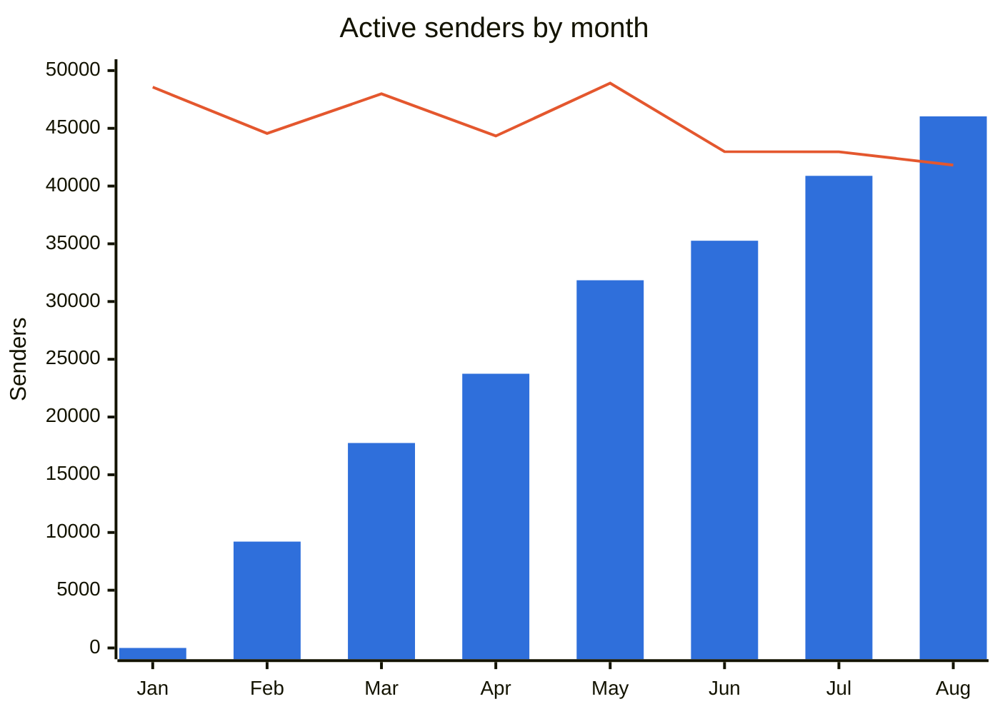
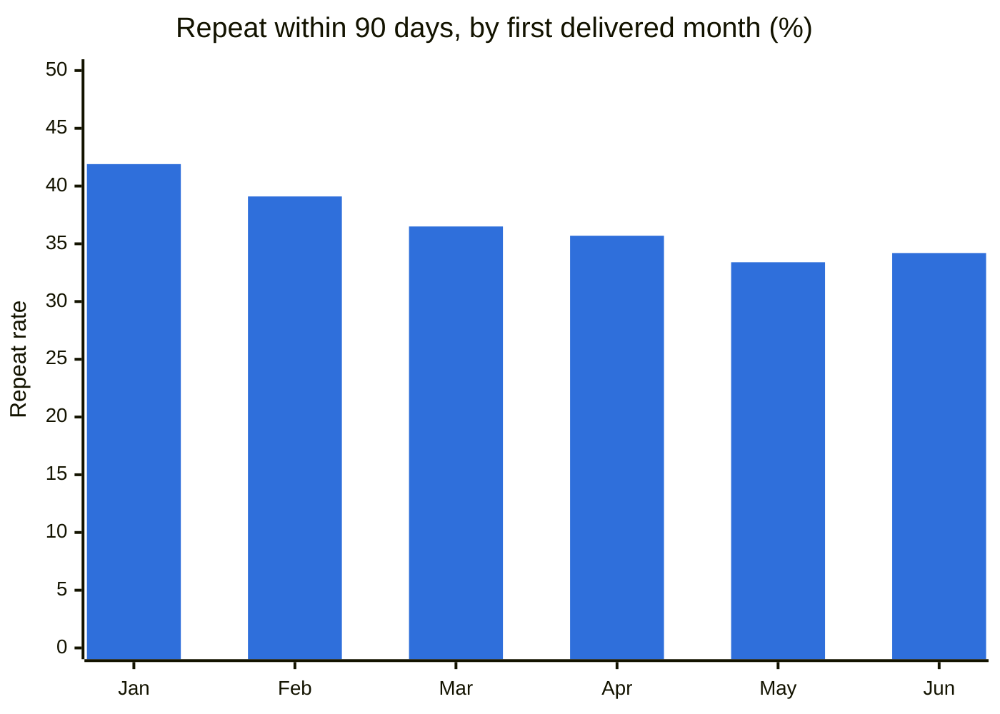
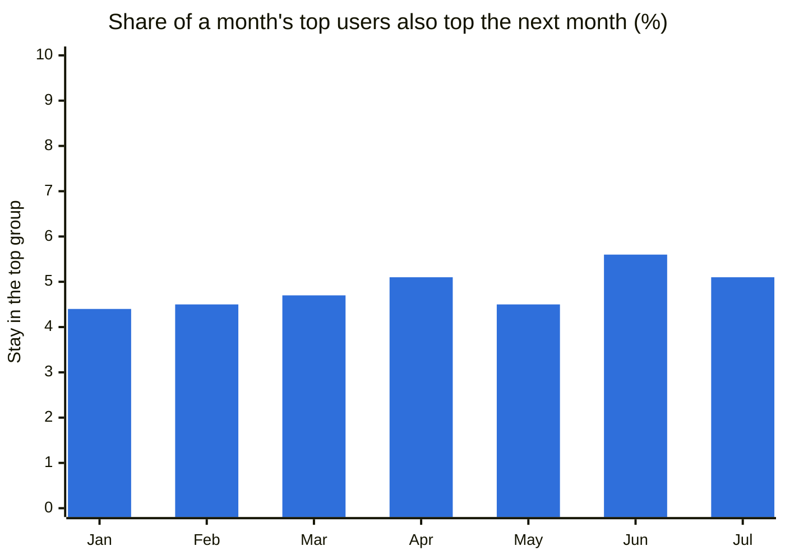
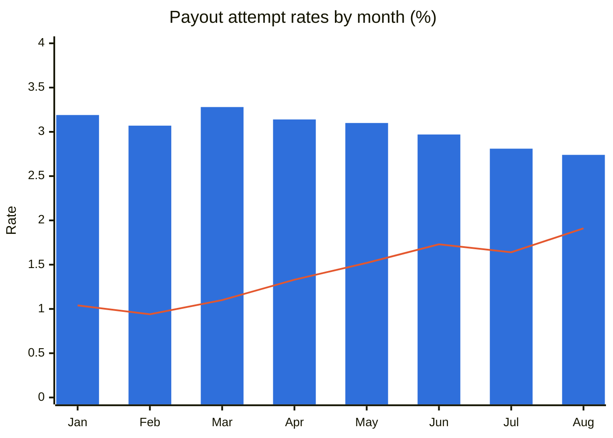
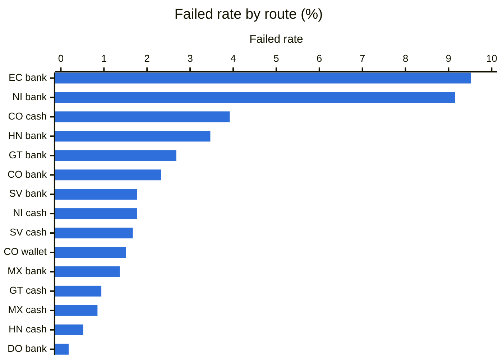
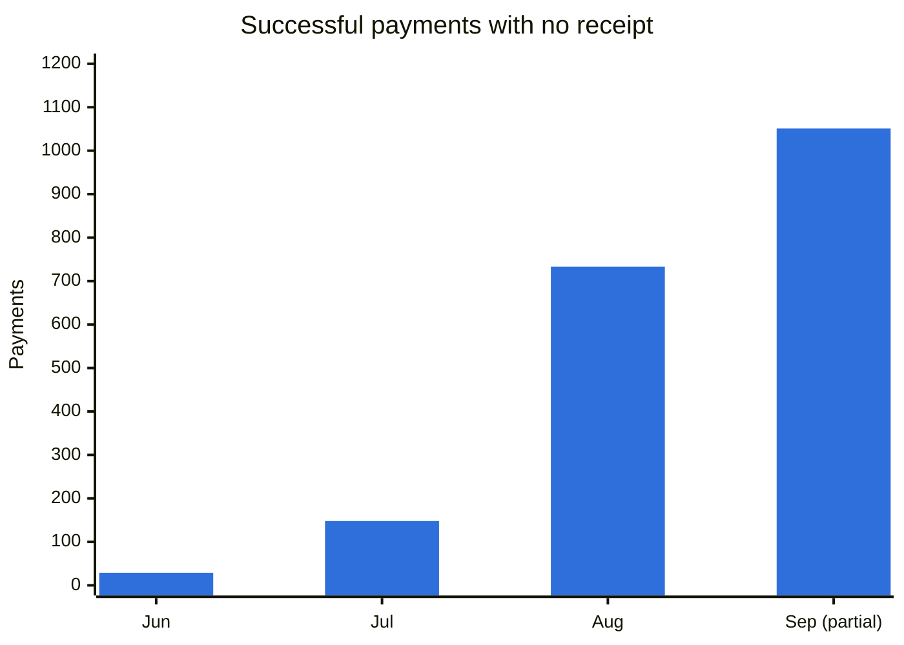

# Business Findings

This document reads the results as a business would. Each finding gives what the data shows, why it matters, and the question it leaves open. The extract can't show why something happened, so no cause is claimed here.

Monthly charts use payment months from January to August unless noted, because September ends on the 22nd. Attempt charts use the attempt month.

| # | Finding | Figures |
|---|---|---|
| 1 | Volume doubled, and returning senders carried the growth | $16.7M to $33.6M a month |
| 2 | Later customer groups repeat less | 41.9% in January, 34.2% in June |
| 3 | The top users' share is stable, but the people change | About 14% of senders, 4.4% to 5.6% stay |
| 4 | The failed rate nearly doubled, while the wider rate fell | 1.04% to 1.91%, and 3.19% to 2.74% |
| 5 | Failure depends on the route | 0.18% to 9.52% |
| 6 | Small groups of payments have no clear payout record | $91.6K, under 0.04% of volume |

## 1. Volume doubled, and returning senders carried the growth

Monthly volume rose from $16.7M in January to $33.6M in August, or 2.0 times. Active senders rose 1.8 times, from 48,571 to 87,848, and the average remittance rose from $305 to $332.



Bars are returning senders. The line is first-seen senders.

First-seen senders stayed between 41,814 and 48,911 a month, while returning senders kept rising. The extract starts in January, so returning senders start at 0, and early first-seen senders include existing customers.

**Why it matters.** New and returning senders grow for different reasons, so one growth number can hide a change in either.

**Open question.** How do first-seen senders compare with sign-up data, which can separate new customers from existing ones?

## 2. Later customer groups repeat less

Among users with a full 90 days to return, 41.9% of January's first-time group sent again within 90 days. June's group reads 34.2%.



January's group includes customers who sent before the extract began, and they may repeat more than new customers. That effect would fade in later months, so part of this fall may come from the extract and not from customers. June covers 33,898 of its 42,982 users, because the rest don't have 90 days yet.

**Why it matters.** Finding 1 depends on returning senders, so the repeat rate of each new group shapes later volume.

**Open question.** Does the fall hold once history before January separates existing customers from new ones?

## 3. The top users' share is stable, but the people change

Over the full extract, 59,511 users make up 50% of volume. Within any month, 13.1% to 14.1% of senders do. That share barely moves, but few of those users are in the next month's group.



August is left out, because September is partial. It reads 3.3%, the low end quoted in docs 01 and 02. 83% of top user-months are a single remittance, so a month's top group mostly reflects one large send.

**Why it matters.** A list of top users built from one month would change almost completely the next month.

**Open question.** Which window best identifies a high-value customer?

## 4. The failed rate nearly doubled, while the wider rate fell

The failed rate rose from 1.04% in January to 1.91% in August. The unsuccessful rate, which adds cancellations, fell from 3.19% to 2.74%. Failed attempts rose from 575 to 1,975 a month, and cancelled attempts fell from 1,229 to 874.



Bars are the unsuccessful rate. The line is the failed rate.

Provider 12 shows the same pattern. Its cancellations stop on August 10 as its failures rise, while its non-delivery holds steady.

**Why it matters.** The two rates point in opposite directions. A report on either one alone gives a different view of payout quality.

**Open question.** What does each provider mean by `failed` and `cancelled`, and which rate should the business track?

## 5. Failure depends on the route

Failed rates range from 0.18% to 9.52% across destinations and payout types, on routes with at least 1,000 decided attempts. Mexico bank payouts are 56% of decided attempts, at 1.37%. The two highest routes are small, with one provider each.



So an overall provider rate partly reflects where a provider operates. Providers 5 and 7 are close overall, but not against other providers on the same routes:

| Provider | Failed rate | Peers on the same routes | Unsuccessful rate against peers |
|---|---:|---:|---:|
| 5 | 2.83% | 4.21% | 0.23 times |
| 7 | 2.98% | 1.19% | 1.22 times |

Routing isn't random, so this describes the data and doesn't show what a change in routing would do.

**Why it matters.** Overall rates alone can't rank providers, because each one serves a different mix of routes.

**Open question.** How is traffic assigned today, and would a comparison on the same routes change any of those choices?

## 6. Small groups of payments have no clear payout record

1,961 successful payments have no receipt. They begin in June and total $40.7K.



Separately, 182 payments ($50.9K) are `SUCCESSFUL` with every payout failed or cancelled and no refund. Neither group counts as amount transacted. Together they're under 0.04% of volume.

**Why it matters.** The amounts are small, but the first group is growing quickly, and neither group can be explained from this extract.

**Open question.** What product are the no-receipt payments, and how do provider statements show the 182 closing?

## Limits

The extract covers under 9 months, with nothing before January. It has no costs, marketing, or customer attributes, so these findings can't show profitability or the effect of any campaign. Chargebacks aren't a finding here, because the rate is low and recent months haven't matured. The README's "If I owned this" section says what I'd do next.

## Reproduce

| Finding | Source |
|---|---|
| 1 | `dbt show -s mart_monthly_volume --limit 12` |
| 2 | `dbt show -s mart_recurring_cohorts --limit 12` |
| 3 | `analysis/results/11_users_beneficiaries.md`, section Y3.3 |
| 4 | The first command below |
| 5 | `analysis/results/17_provider_mix.md`, sections M1 and M2 |
| 6 | The second command below, and `mart_known_issues` |

```bash
dbt show --limit 12 --inline "select date_trunc('month', attempt_at) as attempt_month, count(case when attempt_status = 'failed' then 1 end) as failed, count(case when attempt_status = 'cancelled' then 1 end) as cancelled, count(case when attempt_status = 'delivered' then 1 end) as delivered from {{ ref('int_payout_attempts') }} group by 1 order by 1"
```

```bash
dbt show --limit 12 --inline "select payment_month, count(*) as payments, sum(customer_paid_usd) as usd from {{ ref('fct_remittances') }} where is_successful_without_receipt group by 1 order by 1"
```
